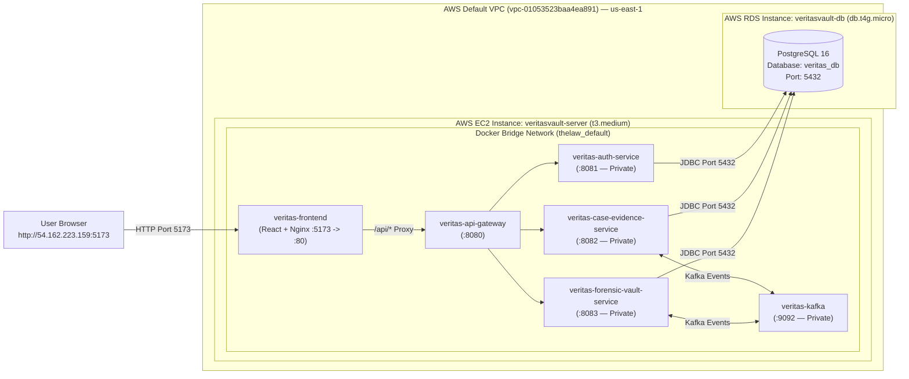

# VeritasVault — AWS Cloud Deployment Reference Guide (RDS + EC2 + Docker Compose)

This document records every step, setting, and command used to deploy **VeritasVault** (Microservices + Apache Kafka + React/Nginx Frontend) to **AWS RDS (PostgreSQL 16)** and **AWS EC2 (Ubuntu + Docker Compose)** in the **US East (N. Virginia — `us-east-1`)** region.

---

## 1. Cloud Architecture Overview



---

## 2. Part 1 — AWS RDS (PostgreSQL Cloud Database) Setup

### A. Navigating to RDS
1. Log into the **AWS Management Console** and select region **United States (N. Virginia — `us-east-1`)**.
2. Search for **RDS** -> click **Aurora and RDS** -> click **Databases** -> click **Create database** -> select **Full configuration**.

### B. Exact RDS Settings Configured

| Section | Setting | Value Chosen | Why We Chose It |
| :--- | :--- | :--- | :--- |
| **Engine options** | Engine type | `PostgreSQL` | Matches our `org.postgresql:postgresql` driver and local Docker database. |
| **Engine version** | Version | `PostgreSQL 16.11-R1` | Matches our `postgres:16-alpine` version in `docker-compose.yml`. |
| **Templates** | Template | `Free tier` | Uses Free Tier hardware (`db.t4g.micro`, 20 GiB storage) at $0 cost. |
| **Availability** | Deployment options | `Single-AZ DB instance deployment (1 instance)` | Runs 1 primary database instance (Multi-AZ is paid only). |
| **Settings** | DB instance identifier | `veritasvault-db` | Name of the RDS server in AWS Console. |
| **Credentials** | Master username | `postgres` | Matches `SPRING_DATASOURCE_USERNAME` in our services. |
| | Credentials management | `Self managed` | Avoids paid AWS Secrets Manager fees; uses standard password auth. |
| | Master password | `postgrespassword` | Matches `SPRING_DATASOURCE_PASSWORD` in our services. |
| **Instance config** | DB instance class | `Burstable classes` -> `db.t4g.micro` | 2 vCPUs, 1 GiB RAM (AWS Free Tier instance class). |
| **Storage** | Storage type & size | `General Purpose SSD (gp2)` — `20 GiB` | 20 GiB SSD included in AWS Free Tier. |
| | Storage autoscaling | Unchecked `Enable storage autoscaling` | Prevents AWS from auto-expanding disk past the 20 GiB Free Tier limit. |
| **Connectivity** | Compute resource | `Don't connect to an EC2 compute resource` | Allows connecting via Endpoint URL from EC2 and pgAdmin. |
| | VPC | `Default VPC (vpc-01053523baa4ea891)` | Main AWS virtual network with internet routing pre-configured. |
| | DB subnet group | `default-vpc-01053523baa4ea891` | Default subnets across N. Virginia Availability Zones. |
| | **Public access** | **`Yes`** | Assigns a public IP to the RDS Endpoint so external connections work. |
| | VPC security group | `Choose existing` -> `default (sg-02c010939a6dc9258)` | Firewall group controlling port `5432` access. |
| | Database port | `5432` | Standard PostgreSQL TCP port. |
| **Monitoring** | Database Insights | `Standard` (`7 days (free)`) | Free basic monitoring without paid CloudWatch retention fees. |
| | Additional monitoring | All unchecked | Avoids paid CloudWatch log export fees. |
| **Additional configuration** | **Initial database name** | **`veritas_db`** | Instructs AWS to automatically run `CREATE DATABASE veritas_db;` on boot. |
| | Deletion protection | Unchecked | Allows easy cleanup/deletion after project grading. |

### C. RDS Security Group (Firewall Rule)
- **Security Group ID:** `sg-02c010939a6dc9258` (`default`)
- **Inbound Rule:**
  - **Type:** `PostgreSQL`
  - **Protocol:** `TCP`
  - **Port Range:** `5432`
  - **Source:** `Anywhere-IPv4` (`0.0.0.0/0`) *(or restrict to EC2 Security Group `sg-09179e300ebb6bed3` for private-only EC2 access)*

### D. Resulting RDS Connection Details
- **Endpoint:** `veritasvault-db.ckf0yi44iig0.us-east-1.rds.amazonaws.com`
- **Port:** `5432`
- **Database Name:** `veritas_db`
- **JDBC URL:**
  ```text
  jdbc:postgresql://veritasvault-db.ckf0yi44iig0.us-east-1.rds.amazonaws.com:5432/veritas_db
  ```

---

## 3. Part 2 — Connecting `docker-compose.yml` to AWS RDS

In `docker-compose.yml`, the 3 database-backed microservices (`auth-service`, `case-evidence-service`, `forensic-vault-service`) use environment variable substitution with a local fallback:

```yaml
    environment:
      SPRING_DATASOURCE_URL: ${SPRING_DATASOURCE_URL:-jdbc:postgresql://postgres:5432/veritas_db}
      SPRING_DATASOURCE_USERNAME: ${SPRING_DATASOURCE_USERNAME:-postgres}
      SPRING_DATASOURCE_PASSWORD: ${SPRING_DATASOURCE_PASSWORD:-postgrespassword}
```

- **Local Laptop Behavior:** When no `.env` file is present, Docker Compose uses `jdbc:postgresql://postgres:5432/veritas_db` (local `veritas-postgres` container).
- **AWS EC2 Cloud Behavior:** When `.env` contains `SPRING_DATASOURCE_URL=jdbc:postgresql://veritasvault-db.ckf0yi44iig0.us-east-1.rds.amazonaws.com:5432/veritas_db`, Docker Compose connects all 3 microservices to **AWS RDS** and Hibernate (`ddl-auto: update`) automatically creates all tables and seeds default accounts.

---

## 4. Part 3 — AWS EC2 (Cloud Application Server) Setup

### A. Navigating to EC2
1. In the AWS Console (`us-east-1`), search for **EC2** -> click **Instances** -> click **Launch instances**.

### B. Exact EC2 Settings Configured

| Section | Setting | Value Chosen | Why We Chose It |
| :--- | :--- | :--- | :--- |
| **Name and tags** | Name | `veritasvault-server` | Display name for the EC2 virtual machine. |
| **Application & OS Images (AMI)** | OS Image | `Ubuntu` (`Ubuntu Server LTS, 64-bit x86`) | Includes official `docker.io` and `docker-compose-v2` packages in `apt`. |
| **Instance type** | Instance type | `t3.medium` (2 vCPU, 4 GiB RAM) | Provides 4 GB RAM so all 4 Spring Boot JVMs + Kafka + Nginx run smoothly without Out-Of-Memory errors. |
| **Key pair (login)** | Key pair | `Proceed without a key pair` (or `veritas-key.pem`) | We connect directly via browser-based **EC2 Instance Connect**. |
| **Network settings** | VPC | `vpc-01053523baa4ea891` | Same VPC as `veritasvault-db` RDS for sub-millisecond internal routing. |
| | Auto-assign public IP | `Enable` | Assigns public IPv4 address (`54.162.223.159`). |
| | Firewall (Security Group) | `Create security group` (`launch-wizard-1` / `sg-09179e300ebb6bed3`) | Controls which ports are public vs. private. |
| **Configure storage** | Root volume | `25 GiB` `gp3` SSD | Increased from default `8 GiB` to `25 GiB` (within 30 GiB Free Tier) to hold Maven/Node Docker build layers. |

### C. EC2 Security Group (`sg-09179e300ebb6bed3` / `launch-wizard-1`) Inbound Rules

| Type | Protocol | Port Range | Source | Purpose |
| :--- | :--- | :--- | :--- | :--- |
| `SSH` | `TCP` | `22` | `0.0.0.0/0` | Admin terminal access via AWS Browser **EC2 Instance Connect**. |
| `HTTP` | `TCP` | `80` | `0.0.0.0/0` | Standard HTTP web traffic. |
| `HTTPS` | `TCP` | `443` | `0.0.0.0/0` | Standard HTTPS web traffic. |
| `Custom TCP` | `TCP` | `5173` | `0.0.0.0/0` | **Public entry point for `veritas-frontend` (React + Nginx).** |
| `Custom TCP` | `TCP` | `8080` | `0.0.0.0/0` | **API Gateway (`veritas-api-gateway`).** |

> **Private Microservices Isolation:** Ports `8081` (`auth-service`), `8082` (`case-evidence-service`), `8083` (`forensic-vault-service`), and `9092` (`kafka`) are **NOT** opened in the EC2 Security Group. They are 100% private inside the Docker bridge network (`thelaw_default`) and can only be reached through the API Gateway.

---

## 5. Part 4 — Commands Executed on the EC2 Ubuntu Terminal

After selecting `veritasvault-server` in EC2 -> clicking **Connect** -> **EC2 Instance Connect**, we ran these exact 4 commands:

### Step 1: Install Docker, Docker Compose v2, and Git
```bash
sudo apt update && sudo apt install -y docker.io docker-compose-v2 git
```

### Step 2: Clone the Project Repository from GitHub
```bash
git clone -b adding-the-microservices https://github.com/Nightowl-ops/THELaw.git && cd THELaw
```

### Step 3: Create the `.env` File Pointing to AWS RDS
```bash
echo "SPRING_DATASOURCE_URL=jdbc:postgresql://veritasvault-db.ckf0yi44iig0.us-east-1.rds.amazonaws.com:5432/veritas_db" > .env && cat .env
```

### Step 4: Build & Start All Containers in Detached Mode
```bash
sudo docker compose up -d --build
```

---

## 6. Useful Day-to-Day EC2 & Docker Management Commands

### Check Running Containers on EC2
```bash
cd ~/THELaw
sudo docker compose ps
```

### View Live Logs of Any Service on EC2
```bash
sudo docker compose logs -f auth-service
sudo docker compose logs -f case-evidence-service
sudo docker compose logs -f forensic-vault-service
```

### Pull Latest GitHub Changes & Rebuild on EC2
```bash
cd ~/THELaw
git pull origin adding-the-microservices
sudo docker compose up -d --build
```

### How to Pause (Stop) & Resume Your AWS Resources to Save Credits
1. **To Pause EC2 when not using it:**
   - Go to **EC2 -> Instances**, select `veritasvault-server` -> click **Instance state -> Stop instance**.
   - *(Note: When you later click **Start instance**, AWS assigns a new Public IPv4 address — check the new `Public IPv4 address` on the EC2 page and open `http://<NEW-IP>:5173`!)*
2. **To Pause RDS when not using it:**
   - Go to **RDS -> Databases**, select `veritasvault-db` -> click **Actions -> Stop temporarily**.
