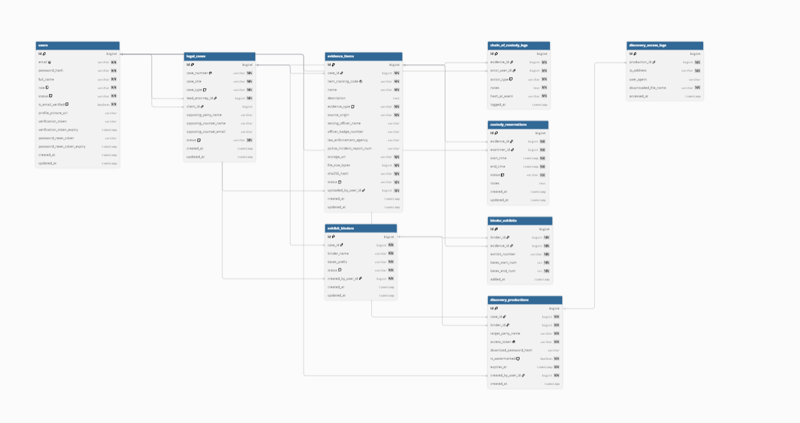

# VeritasVault: Digital Evidence Vault & Chain-of-Custody Management System

[](https://spring.io/projects/spring-boot)
[](https://www.oracle.com/java/)
[](https://www.postgresql.org/)
[](https://spring.io/projects/spring-security)
[](http://localhost:8085/swagger-ui/index.html)

**VeritasVault** is an enterprise-grade digital forensics vault and legal custody lifecycle platform built for law firms, forensic labs, judicial counsel, and litigation teams. The platform guarantees strict forensic integrity for digital assets (device extractions, video/audio dumps, network logs, and electronic discovery) through streaming cryptographic verification, immutable chain-of-custody audit ledgers, lab workstation concurrency serialization, trial exhibit Bates stamping, and secure token-hashed discovery productions.

---

## The Legal Problem & Case Precedents

In high-stakes criminal and civil litigation, a multi-million dollar verdict or murder trial can collapse over one single vulnerability: **a broken chain of custody**. If evidence cannot be proven pristine, it gets suppressed by the court under evidence spoliation and admissibility rules.

Consider the judicial precedents that motivated this platform:
1. **The O.J. Simpson Murder Trial (1995)**: Evidence integrity was fatally compromised when a vial of blood was carried in an investigator's pocket without a contemporaneous, logged custody handoff.
2. **United States v. Ross Ulbricht (Silk Road, 2015)**: Corrupt federal agents secretly manipulated seized digital server records because there was no cryptographic audit trail recording who touched the data and when.
3. **Qualcomm Inc. v. Broadcom Corp. ($8.5M Discovery Disaster)**: Qualcomm was hit with unprecedented judicial sanctions and attorneys were disciplined because tens of thousands of critical electronic discovery emails were hidden, mishandled, and omitted from discovery productions.
4. **Commonwealth v. Karen Read (2024)**: Digital crash data and phone extractions faced intense scrutiny over whether lab examiners followed standardized custody protocols.
5. **The Hinton State Laboratory Scandal (Annie Dookhan, 2012–2017)**: Over 24,000 criminal drug convictions were vacated because lab technicians falsified test records and signed off on unverified samples.
6. **State v. Sweet (647 S.E.2d 202, South Carolina)**: Emphasized that where a link in the chain of custody is missing, the physical evidence is inadmissible as a matter of law.

### How VeritasVault Solves This:
* **Every piece of evidence is cryptographically fingerprinted (SHA-256)** upon ingestion.
* **Every physical or digital touch is permanently recorded** in an append-only ledger (`actor`, `action`, `timestamp`, `hash_at_event`).
* **Lab bookings are serialized** using database-level pessimistic row locks, making double-booking physically impossible.
* **Trial Binders are locked with an Immutability Freeze** once finalized or served.
* **Opposing Counsel access is secured via SHA-256 hashed one-time discovery links** with full proof-of-service logging.

---

## Core Domain Model & Relational Architecture



### 1. Users & RBAC (`users`)
In forensic custody, actors must operate within strict legal boundaries. The system enforces 4 distinct server-controlled roles:
* `ROLE_ADMIN`: Vault configuration, user management, audit oversight, and soft-delete controls.
* `ROLE_ATTORNEY`: Docket creation, case management, discovery production issuance, and trial exhibit binder preparation.
* `ROLE_FORENSIC_EXAMINER`: Lab scheduling, evidence check-out/check-in, analysis logging, and tamper verification.
* `ROLE_CLIENT`: Read-only access restricted strictly to their assigned legal dockets and evidentiary updates.

*Note on external actors*: Law enforcement operates in closed RMS/CAD systems, so police badge numbers and incident report IDs are captured directly at evidence intake (`officer_badge_number`, `police_incident_report_num`). Judges remain neutral and never log into private attorney vaults; instead, they receive formal Bates-stamped exhibits and certified custody packages. Opposing counsel does not have internal accounts; they access discovery documents via tokenized expiring portals.

### 2. Legal Cases (`legal_cases`)
The relational anchor for all proceedings. Digital evidence, binders, and discovery packages cannot exist in a vacuum; they must legally belong to an official docket number (e.g., `CV-2026-0042`). Supports case status lifecycle (`ACTIVE`, `PENDING`, `CLOSED`, `ARCHIVED`), opposing counsel contact records, lead attorney assignment, and client ownership filtering.

### 3. Forensic Evidence Vault (`evidence_items`)
Stores evidence metadata, source origin, seizing officer credentials, storage paths, file sizes, and streaming cryptographic hashes. Evidence lifecycle is governed by a strict state machine:
`COLLECTED` &rarr; `IN_STORAGE` &rarr; `AVAILABLE` &harr; `RESERVED` &harr; `IN_LAB` &rarr; `ADMITTED` (terminal courtroom record) or `SEQUESTERED` (court-ordered quarantine).

### 4. Chain-of-Custody Ledger (`chain_of_custody_logs`)
An append-only, tamper-evident chronological ledger. Records:
* **Who** held or touched it (`actor_user_id`)
* **What** item was handled (`evidence_id`)
* **What** action was performed (`action_type`: `INGEST`, `CHECK_OUT`, `CHECK_IN`, `TRANSFER`, `STATUS_CHANGE`)
* **Is it still pristine?** (`hash_at_event` re-computed and compared on return)

### 5. Lab Workstation Reservations (`custody_reservations`)
Prevents two examiners from booking or analyzing the same piece of physical evidence simultaneously. Enforces interval overlap checks and pessimistic row locking.

### 6. Forensic Lab Reports & Tamper Verification (`forensic_lab_reports`) - *10th Table*
Dispatches background verification tasks to a dedicated 4-worker thread pool (`lab-verifier-pool-1` to `4`). Calculates and compares post-examination SHA-256 hashes against baseline hashes. If tampering is detected, the item is immediately quarantined in `SEQUESTERED` status, preserving digital proof for court testimony.

### 7. Trial Exhibit Binders & Bates Stamping (`exhibit_binders`, `binder_exhibits`)
Allows attorneys to assemble trial bundles from admitted evidence. Implements consecutive Bates numbering (e.g., `PLTF-000001` to `PLTF-000045`). Once marked `FINALIZED` or `SERVED`, binders are permanently locked against modifications. If an exhibit is deleted in draft status, the entire sequence is automatically re-indexed so no Bates gaps exist.

### 8. Discovery Productions & Proof of Service (`discovery_productions`, `discovery_access_logs`)
Manages formal productions served on opposing counsel. Instead of storing plaintext URLs, the database stores an **access token hash (`accessTokenHash`)**. Opposing counsel downloads the bundled evidence through `GET /api/discovery/download/{accessToken}`, which verifies the expiration window, access count limit, and logs a tamper-proof timestamped download receipt (Proof of Service).

---

## Technical Highlights & Architecture

### 1. Constant-Memory Streaming Cryptographic Hashing
Computing a hash for multi-gigabyte forensic files (disk images, cell phone dumps) presents a major challenge: memory exhaustion. Naive `Files.readAllBytes()` loads the entire file into RAM, crashing the JVM with an `OutOfMemoryError` on 5 GB+ files.
VeritasVault implements an unbuffered streaming hashing pipeline using `java.security.MessageDigest` and a constant 8 KB buffer (`ChecksumUtils`):
* Streams raw bytes incrementally without holding the payload in heap memory.
* Guarantees an **$\mathcal{O}(1)$ constant memory footprint (~8 KB)** regardless of file size.
* Raised Spring Boot multipart and upload limits to **500 MB** to accommodate forensic disk captures.

### 2. Pessimistic Row Locking & Double-Booking Serialization
To prevent race conditions where two examiners concurrently book or check out the same physical evidence item:
* The reservation engine invokes `findByIdWithPessimisticLock(evidenceId)` with JPA `LockModeType.PESSIMISTIC_WRITE`.
* The database serializes concurrent transactions on that specific row until the booking interval query completes.
* Time-slot collisions immediately return **HTTP 409 Conflict** with explanatory error details.

### 3. Server-Enforced Security & Rate Limiting
* **Role Tamper Resistance**: Registration endpoints unconditionally enforce `ROLE_CLIENT`. Administrative elevation is restricted to authenticated `ROLE_ADMIN` endpoints.
* **Externalized Secrets**: Database passwords, JWT secret keys, and SMTP credentials are externalized to environment variables.
* **Brute-Force Protection**: Custom `RateLimiterFilter` enforces sliding-window in-memory rate limiting (15 requests/minute per IP) on `/api/auth/**`.
* **Standardized REST Error Codes**: Clean JSON error responses: `401 Unauthorized` for bad credentials/tokens, `403 Forbidden` for ownership violations, `409 Conflict` for duplicate emails/case numbers/double-bookings, and sanitized internal 500 errors.

### 4. Real-Time Telemetry via Server-Sent Events (SSE)
Live custody telemetry is broadcast via `SseEmitter` (`/api/notifications/subscribe`):
* Authenticated using JWT via `Authorization: Bearer <token>` or `?token=<jwt>` query parameter (standard for browser `EventSource`).
* Emits events for `CUSTODY_RESERVATION_CREATED`, `CUSTODY_RESERVATION_CANCELLED`, `EVIDENCE_CHECKED_OUT`, and `EVIDENCE_CHECKED_IN`.

---

## Technical Stack

| Layer | Technologies |
| :--- | :--- |
| **Language & Runtime** | Java 17 (OpenJDK / Oracle JDK) |
| **Framework** | Spring Boot 3.3.4 (MVC, Data JPA, Security 6, Validation) |
| **Database** | PostgreSQL 15+ (Production/Dev), H2 in PostgreSQL Mode (Automated Tests) |
| **Authentication** | Stateless JWT (HMAC-SHA256, JJWT 0.12.6), BCrypt Password Hashing |
| **API Documentation** | SpringDoc OpenAPI 3.0 / Swagger UI (Port 8085) |
| **Telemetry & Mail** | Server-Sent Events (`SseEmitter`), Jakarta Mail |
| **Testing** | JUnit 5, Mockito, AssertJ, Spring Security Test, MockMvc |
| **Build Tool** | Apache Maven 3.9+ |

---

## System Documentation Index

Modular domain documentation is maintained inside the [`docs/`](./docs) directory:

| Guide | Link | Topics Covered |
| :---: | :--- | :--- |
| **01** | [**Auth & Security Architecture**](./docs/01-auth-and-security.md) | User onboarding, 24h UUID activation token dispatch, BCrypt hashing, and stateless JWT issuance. |
| **02** | [**Case Management**](./docs/02-case-management.md) | Relational root for legal proceedings, lead attorney assignment, and client dossier linking. |
| **03** | [**Evidence Intake & Hashing**](./docs/03-evidence-and-hashing.md) | Streaming SHA-256 computation, path traversal guards, storage allocation, and intake logging. |
| **04** | [**Chain of Custody Ledger**](./docs/04-chain-of-custody.md) | Append-only, tamper-evident chronological ledger tracking all custody transitions and hashes. |
| **05** | [**Lab Reservations & SSE**](./docs/05-lab-reservations-and-sse.md) | Workstation double-booking collision engine and real-time SSE event broadcasts. |
| **06** | [**Exhibit Binders & Bates**](./docs/06-binders-and-bates.md) | Trial binder bundling, consecutive page Bates offset calculations, and immutability locks. |
| **07** | [**Discovery Production**](./docs/07-discovery-production.md) | Token-gated opposing counsel disclosures, link expiration, and Proof of Service access logging. |
| **08** | [**Unit 3 Concurrency & Threads**](./docs/08-unit3-concurrency-and-threads.md) | 4-worker ExecutorService thread pool, parallel verification, 10th table, and tamper quarantine. |
| **Stories** | [**User Stories & Acceptance**](./docs/user-stories.md) | Agile requirements, acceptance criteria, and operational personas. |
| **Ref** | [**REST API Reference**](./docs/REST-API-Reference.md) | Complete endpoint specifications, HTTP request formats, and query parameters (Port 8085). |
| **Ext** | [**Credits & External Resources**](./docs/Credits%20&%20External%20Resources.md) | Legal research citations, statutory rules of evidence, and design inspirations. |

---

## Quickstart & Local Setup

### 1. Prerequisites
* **Java 17 JDK** installed (`java -version`)
* **PostgreSQL 14+** running locally on port `5432`
* **Git** installed

### 2. Database Initialization
Log into PostgreSQL via `psql` or pgAdmin:
```sql
CREATE DATABASE veritasvault;
```

### 3. Environment Configuration
VeritasVault reads credentials from environment variables with sensible development defaults. To set custom credentials in your terminal:

**On Linux/macOS:**
```bash
export DB_USERNAME=postgres
export DB_PASSWORD=your_postgres_password
export JWT_SECRET=your_512_bit_secret_base64_encoded_string_here
export MAIL_USERNAME=your_gmail@gmail.com
export MAIL_PASSWORD=your_gmail_app_password
```

**On Windows (PowerShell):**
```powershell
$env:DB_USERNAME="postgres"
$env:DB_PASSWORD="your_postgres_password"
$env:JWT_SECRET="your_512_bit_secret_base64_encoded_string_here"
$env:MAIL_USERNAME="your_gmail@gmail.com"
$env:MAIL_PASSWORD="your_gmail_app_password"
```

### 4. Build and Run the Application
From the project root:

**Linux/macOS:**
```bash
./mvnw clean spring-boot:run
```

**Windows:**
```powershell
.\mvnw.cmd clean spring-boot:run
```

The application will launch on **`http://localhost:8085`**.

### 5. Database Seeder & Demo Credentials
Upon first startup, `DatabaseSeeder.java` automatically seeds the database with demo accounts (passwords: `Password123!`):

| Role | Email | Password | Permissions |
| :--- | :--- | :--- | :--- |
| **Admin** | `admin@veritasvault.com` | `Password123!` | System configuration, user management, soft delete |
| **Attorney** | `attorney@veritasvault.com` | `Password123!` | Case creation, binder assembly, discovery distribution |
| **Forensic Examiner** | `examiner@veritasvault.com` | `Password123!` | Lab reservations, evidence check-out/check-in |
| **Client** | `client@veritasvault.com` | `Password123!` | Read-only case & evidence status viewing |

### 6. Interactive API Documentation (Swagger UI)
Once the server is running, explore the fully documented interactive OpenAPI 3.0 UI:
* **Swagger UI:** [http://localhost:8085/swagger-ui/index.html](http://localhost:8085/swagger-ui/index.html)
* **OpenAPI JSON Spec:** [http://localhost:8085/v3/api-docs](http://localhost:8085/v3/api-docs)

### 7. Running Automated Tests
Run the comprehensive JUnit 5 test suite (using an in-memory H2 PostgreSQL compatibility database):
```powershell
.\mvnw.cmd test
```

---

## Major Challenges

1. **Streaming SHA-256 Hashing for Large Forensic Images**:
   Forensic data extractions frequently exceed several gigabytes. Reading the entire byte array into memory with `Files.readAllBytes()` immediately triggered `OutOfMemoryError` in JVM heaps. Implementing an incremental, chunked 8 KB stream with `MessageDigest` and decoupled disk storage kept heap consumption constant at $\mathcal{O}(1)$ while scaling up to the 500 MB upload threshold.
2. **Lab Workstation Concurrency & Double-Booking Race Conditions**:
   When multiple examiners simultaneously attempted to reserve the same physical hard drive for analysis, concurrent HTTP requests could slip through basic interval query checks. We solved this by pairing relational interval exclusion logic with JPA pessimistic row locks (`LockModeType.PESSIMISTIC_WRITE`) on `EvidenceItem`, forcing concurrent booking transactions to serialize at the database level.
3. **Immutability Enforcement & Bates Sequence Re-indexing**:
   Court rules mandate that once a trial binder is served, it cannot be altered. We designed a state machine where `FINALIZED` and `SERVED` statuses are permanent architectural locks. In `DRAFT` status, deleting an exhibit required dynamically re-calculating the entire consecutive Bates number range so that no page citation gaps existed in the trial bundle.
4. **Zero-Knowledge Discovery Links**:
   Sending discovery materials to opposing counsel required token-authenticated URLs without risking evidence leakage if database dumps were exposed. Generating high-entropy 256-bit UUID tokens, returning the raw token in the download link once, and saving only its SHA-256 digest (`accessTokenHash`) in PostgreSQL guarantees that a leaked database dump cannot be used to forge discovery access.

---

## Unsolved Problems

1. **Decentralized Cryptographic Anchoring (Blockchain Notarization)**:
   While VeritasVault stores tamper-evident SHA-256 hashes inside PostgreSQL audit tables, a sophisticated database administrator with direct root access could theoretically update database rows. Periodically anchoring the cumulative Merkle root hash of all chain-of-custody logs into an immutable public blockchain (such as Polygon or Ethereum) would provide incontrovertible third-party proof against internal administrator tampering.
2. **Asynchronous Background Processing for Multi-Gigabyte Uploads**:
   Currently, file uploads and hashing execute synchronously within the HTTP request thread. For 10 GB+ multi-part forensic dumps, client HTTP connections risk network timeouts. Decoupling upload ingestion into an asynchronous worker queue (e.g., Redis / Celery or Spring `@Async` with WebSocket/SSE progress updates) would provide smoother user feedback during large forensic transfers.
3. **Automated Forensic File Carving & EXIF Metadata Parsing**:
   Forensic evidence uploads currently rely on examiner-submitted metadata. Automatically extracting device EXIF coordinates, camera serial numbers, and carving file header signatures upon ingestion would provide automated validation against spoofed file formats.

---

## Future Improvements

1. **Interactive Frontend Courtroom Dashboard**:
   Build a modern Next.js / React legal interface featuring a drag-and-drop Bates binder organizer, PDF viewer with inline page annotations, and real-time SSE toast alerts during active evidence checkout.
2. **Automated Bates Watermarking (PDF/A Generation)**:
   Implement an automated PDF/A rendering engine using Apache PDFBox or iText that physically prints the Bates number (e.g., `PLTF-000042`) onto the lower right corner of every page in the trial binder.
3. **Pluggable Cloud Object Storage (AWS S3 / Azure Blob)**:
   Transition evidence storage from local filesystem paths to encrypted cloud object storage (AWS S3 with Object Lock or Azure Immutable Blob Storage) using pre-signed URLs for zero-latency uploads.
4. **Hardware Key Two-Factor Authentication (WebAuthn / FIDO2 / TOTP)**:
   Enforce multi-factor authentication with hardware security keys (e.g., YubiKey) for forensic examiners and administrators before evidence check-out authorization.
