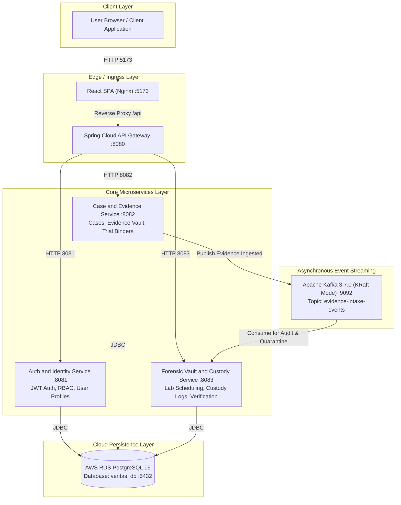
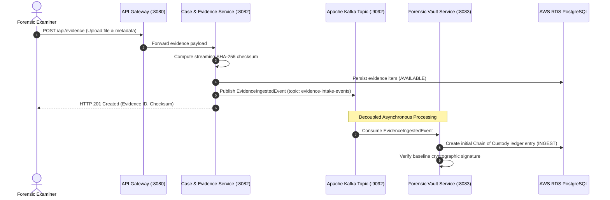

# VeritasVault: Digital Evidence Vault and Chain of Custody Management System

[](https://spring.io/projects/spring-boot)
[](https://www.oracle.com/java/)
[-black.svg)](https://kafka.apache.org/)
[](https://www.docker.com/)
[](https://aws.amazon.com/)
[](https://www.jenkins.io/)
[](http://54.162.223.159:8080)

VeritasVault is an enterprise digital forensics vault and legal custody lifecycle platform built for law firms, forensic labs, judicial counsel, and litigation teams. It provides courtroom grade digital custody tracking, automated evidence hashing, lab scheduling, trial exhibit preparation, and discovery exchange.

In this production release (Unit 4), the monolithic architecture has been refactored into an independently scalable microservices platform, containerized with Docker, decoupled using Apache Kafka event streaming, cached with Spring Cache, verified with Cucumber BDD test suites, and deployed to AWS (RDS PostgreSQL, EC2, and ECR) through an automated Jenkins CI/CD pipeline.

---

## 1. System Architecture



---

## 2. Microservice Boundaries and Responsibilities

The system is decomposed into business capabilities where each service owns its functionality, configuration, dependencies, and APIs:

| Microservice | Port | Business Responsibility | Communication |
| :--- | :---: | :--- | :--- |
| **API Gateway** | `8080` | Reverse proxy, path routing, unified CORS handling, and edge request dispatching. | Synchronous HTTP / Spring Cloud Gateway |
| **Auth Service** | `8081` | User registration, authentication, JWT issuing and validation, profile storage, and role based access control (Admin, Attorney, Examiner, Client). | Synchronous REST |
| **Case and Evidence Service** | `8082` | Legal dockets, evidence file ingestion, SHA-256 integrity checksum calculation, Bates stamped exhibit binders, and discovery exchange. | Synchronous REST + Kafka Producer |
| **Forensic Vault Service** | `8083` | Chain of custody logging, physical evidence workstation reservations, tamper audits, and real time Server-Sent Events (SSE). | Synchronous REST + Kafka Consumer |
| **React Frontend** | `5173` | Production React SPA bundled via Vite and served with Nginx reverse proxy routing. | Browser UI to Gateway |

---

## 3. Asynchronous Messaging with Apache Kafka

To decouple evidence intake from downstream forensic auditing, Apache Kafka operates in modern KRaft mode (no Zookeeper required).



### Kafka Topic Specifications

* **Topic Name:** `evidence-intake-events`
* **Producer:** `case-evidence-service` (`EvidenceKafkaProducer`)
* **Consumer:** `forensic-vault-service` (`EvidenceKafkaConsumer`)
* **Trigger Workflow:** Dispatched immediately when physical or digital evidence is cataloged into a legal case.
* **Payload Structure:**
```json
{
  "evidenceId": 142,
  "caseId": 18,
  "evidenceName": "Samsung Galaxy S22 Physical Extraction",
  "sha256Checksum": "e3b0c44298fc1c149afbf4c8996fb92427ae41e4649b934ca495991b7852b855",
  "trackingCode": "EVD-2026-0814",
  "actorUsername": "examiner@veritasvault.com",
  "timestamp": "2026-11-17T10:15:30Z"
}
```

### Kafka Reliability Strategy
1. **At-Least-Once Delivery:** Producer specifies `acks=all` with automatic retries to prevent message loss.
2. **Consumer Fault Tolerance:** The consumer relies on consumer groups. If the forensic service container restarts, unacknowledged offsets are resumed from the commit log without message loss.
3. **Consumer Idempotency:** The consumer queries existing custody records by `evidence_id` and action `INGEST` before creating records, preventing duplicate entries if a network retry occurs.

---

## 4. Service Data Ownership

Each microservice manages dedicated database tables to prevent cross-service database coupling:

```
veritas_db (AWS RDS PostgreSQL)
├── auth-service Domain
│   └── users (User profiles, password hashes, roles, status)
│
├── case-evidence-service Domain
│   ├── legal_cases (Dockets, status, assigned counsel)
│   ├── evidence_items (Evidence files, SHA-256 hashes, custody state)
│   ├── exhibit_binders (Trial binders, Bates numbering index)
│   ├── binder_exhibits (Binder association entries)
│   ├── discovery_productions (Discovery bundles, access tokens)
│   └── discovery_access_logs (Opposing counsel download receipts)
│
└── forensic-vault-service Domain
    ├── chain_of_custody_logs (Immutable chronological handling ledger)
    ├── custody_reservations (Lab workstation reservations and locks)
    └── forensic_lab_reports (Tamper verification reports and findings)
```

---

## 5. Caching and Interactive API Documentation

### Spring Caching Strategy
To reduce database query load for frequently requested, slow changing entities, Spring Cache (`@EnableCaching`) is enabled:
* **`AdminUserService`:** Cached with `@Cacheable(value = "users", key = "#id")`. Evicted upon user updates with `@CacheEvict(value = "users", key = "#id")`.
* **`LegalCaseService`:** Case lookups cached with `@Cacheable(value = "cases", key = "#id")` and invalidated when case status or dockets are modified.

### Interactive OpenAPI / Swagger UI
Every service includes `springdoc-openapi-starter-webmvc-ui` (v2.6.0). Documentation is accessible directly via the API Gateway or individual service ports:
* **Auth Service Docs:** `http://54.162.223.159:8081/swagger-ui/index.html`
* **Case and Evidence Docs:** `http://54.162.223.159:8082/swagger-ui/index.html`
* **Forensic Vault Docs:** `http://54.162.223.159:8083/swagger-ui/index.html`

---

## 6. Automated Testing (Cucumber BDD)

Each microservice contains Behavior Driven Development (BDD) test suites written in Gherkin feature files with Cucumber steps.

* Feature files location: `src/test/resources/features/`
* Step definitions location: `src/test/java/.../steps/`

To run the automated test suites:
```bash
# Run tests in Auth Service
mvn test -f auth-service/pom.xml

# Run tests in Case & Evidence Service
mvn test -f case-evidence-service/pom.xml

# Run tests in Forensic Vault Service
mvn test -f forensic-vault-service/pom.xml
```

All Cucumber scenarios pass with zero failures and zero errors before code can be packaged or deployed.

---

## 7. Cloud Deployment (AWS RDS + EC2 + ECR)

The live production system is hosted on Amazon Web Services in region `us-east-1` (N. Virginia):

* **AWS RDS (PostgreSQL 16):** Database identifier `veritasvault-db.ckf0yi44iig0.us-east-1.rds.amazonaws.com`.
  * Secured via Security Group Chaining (`sg-02c010939a6dc9258`) restricted to traffic originating from the EC2 security group (`sg-09179e300ebb6bed3`).
* **AWS EC2 (Ubuntu 24.04 LTS):** Instance identifier `i-0058f806ef1591c17` (`t3.medium`).
  * Public IP: `54.162.223.159`
  * Attached IAM Role: `EC2-ECR-Role` with `AmazonEC2ContainerRegistryPowerUser` policy.
* **AWS ECR (Elastic Container Registry):** 5 private container repositories under account `411711548396`:
  1. `411711548396.dkr.ecr.us-east-1.amazonaws.com/veritas-auth-service`
  2. `411711548396.dkr.ecr.us-east-1.amazonaws.com/veritas-case-evidence-service`
  3. `411711548396.dkr.ecr.us-east-1.amazonaws.com/veritas-forensic-vault-service`
  4. `411711548396.dkr.ecr.us-east-1.amazonaws.com/veritas-api-gateway`
  5. `411711548396.dkr.ecr.us-east-1.amazonaws.com/veritas-frontend`
  * Tagged with semantic version `1.0.0` and `latest`.

### Live Production Web Application
* **Frontend URL:** `http://54.162.223.159:5173`
* **API Gateway Route:** `http://54.162.223.159:8080/api`

---

## 8. Continuous Integration and Continuous Deployment (Jenkins CI/CD)

The CI/CD pipeline is fully defined as code in the project root [Jenkinsfile](Jenkinsfile) and executed via Jenkins Declarative Pipeline syntax.

```
Git Push to GitHub
       │
       ▼
[Stage 1: Checkout] ➔ Clones source branch from GitHub
       │
       ▼
[Stage 2: Automated BDD Testing] ➔ Runs Cucumber test suites across microservices (mvn test)
       │
       ▼
[Stage 3: Package Application] ➔ Builds executable Spring Boot JARs and Vite production bundle
       │
       ▼
[Stage 4: Build Docker Images] ➔ Validates container images for all 5 services
       │
       ▼
[Stage 5: Push Images to AWS ECR] ➔ Authenticates via aws-credentials and pushes versioned tags
       │
       ▼
[Stage 6: Continuous Deployment to AWS EC2] ➔ Triggers EC2 pull and container recreate
       │
       ▼
Finished: SUCCESS (All stages green in Jenkins Blue Ocean)
```

### Automated Trigger (Poll SCM)
The pipeline is configured with automated SCM polling:
* Schedule: `H/5 * * * *` (Checks GitHub every 5 minutes for new commits).
* Execution Mode: When code is pushed, Jenkins automatically triggers, tests the code, verifies the build, and prepares deployment without manual intervention.

---

## 9. Running the Application Locally

Anyone cloning this repository can launch the entire distributed stack locally with a single command. No local installations of Java, Maven, PostgreSQL, or Kafka are required.

### Prerequisites
* Docker Desktop 24+ and Docker Compose v2+ installed.

### Start All Services
```bash
# Clone the repository
git clone https://github.com/Nightowl-ops/THELaw.git
cd THELaw

# Launch PostgreSQL, Kafka, all 4 Spring Boot microservices, and React Frontend
docker compose up -d
```

### Access Points
* React Frontend: `http://localhost:5173`
* API Gateway: `http://localhost:8080`
* Auth Service: `http://localhost:8081`
* Case and Evidence Service: `http://localhost:8082`
* Forensic Vault Service: `http://localhost:8083`
* pgAdmin 4: `http://localhost:5050` (Login: `admin@veritasvault.com` / `adminpassword`)

### Default Test Credentials
* Admin: `admin@veritasvault.com` / `Password123!`
* Forensic Examiner: `examiner@veritasvault.com` / `Password123!`
* Attorney: `attorney@veritasvault.com` / `Password123!`
* Client: `client@veritasvault.com` / `Password123!`

---

## 10. Environment Variables Reference

| Variable Name | Description | Default Local Value | Production AWS Value |
| :--- | :--- | :--- | :--- |
| `SPRING_DATASOURCE_URL` | JDBC Database Connection URL | `jdbc:postgresql://postgres:5432/veritas_db` | `jdbc:postgresql://veritasvault-db.ckf0yi44iig0.us-east-1.rds.amazonaws.com:5432/veritas_db` |
| `SPRING_DATASOURCE_USERNAME` | Database username | `postgres` | `postgres` |
| `SPRING_DATASOURCE_PASSWORD` | Database password | `postgrespassword` | Configured securely via AWS environment |
| `SPRING_KAFKA_BOOTSTRAP_SERVERS` | Kafka broker endpoint | `kafka:9092` | `kafka:9092` |
| `AUTH_SERVICE_URL` | Route target for Auth service | `http://auth-service:8081` | `http://auth-service:8081` |
| `CASE_SERVICE_URL` | Route target for Case service | `http://case-evidence-service:8082` | `http://case-evidence-service:8082` |
| `FORENSIC_SERVICE_URL` | Route target for Forensic service | `http://forensic-vault-service:8083` | `http://forensic-vault-service:8083` |
| `APP_STORAGE_UPLOAD_DIR` | Forensic disk storage volume | `/app/uploads` | `/app/uploads` |

---

## 11. Project Summary and Unit 4 Deliverables

This project fulfills all criteria of the Unit 4 Productionization Project:
1. **Continuation of Prior Projects:** Retained all business logic, users, cases, evidence hashing, Bates stamping, and custody workflows.
2. **Microservices Decomposition:** Refactored into 4 independent Spring Boot services + API Gateway with clear bounded contexts.
3. **Containerization:** Complete Dockerfiles and multi-container Docker Compose orchestration for zero-dependency execution.
4. **Asynchronous Messaging:** Integrated Apache Kafka for event-driven evidence processing and auditing.
5. **Caching:** Spring Caching implemented on core read paths.
6. **Cloud Deployment:** Live in production on AWS (RDS PostgreSQL, EC2, and private ECR container registry).
7. **CI/CD Automation:** Declarative Jenkins pipeline automating testing, packaging, and deployment verification.
