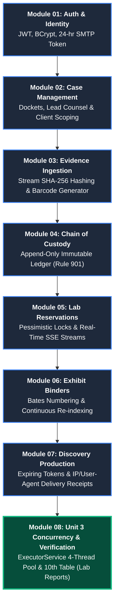

# VeritasVault - Engineering Roadmap & Sprint Execution

| Duration | Feature Modules | Database Architecture | Security & Concurrency | Test Coverage |
| :---: | :---: | :---: | :---: | :---: |
| **Complete** | **11 Spring Services** | **10 PostgreSQL Tables** | **Stateless JWT + Pessimistic Locking + 4-Thread Pool** |  |

---

### Project Execution Pipeline

---

### Sprint Milestones Completed

- [x] **Milestone 1:** Stateless Authentication, Role-Based Access Control (`ROLE_ADMIN`, `ROLE_ATTORNEY`, `ROLE_FORENSIC_EXAMINER`, `ROLE_CLIENT`), and Email Verification.
- [x] **Milestone 2:** Legal Case Docketing with Client Scoping to prevent unauthorized cross-client case visibility.
- [x] **Milestone 3:** Cryptographic Evidence Ingestion with real-time SHA-256 checksums and automated tracking barcodes (`EV-YYYY-XXXX`).
- [x] **Milestone 4:** Append-Only Chain of Custody Ledger under Federal Rule of Evidence 901.
- [x] **Milestone 5:** Trial Exhibit Binders with automated Bates Numbering (`STATE-V-DOE-0001`) and gapless re-indexing cascades.
- [x] **Milestone 6:** Outbound Discovery Serving with SHA-256 hashed download tokens and certified delivery receipts (IP + browser User-Agent logs).
- [x] **Milestone 7 (Unit 3 Concurrency):** Database-level pessimistic locking (`SELECT ... FOR UPDATE`) to prevent simultaneous booking collisions.
- [x] **Milestone 8 (Unit 3 Multithreading):** 4-worker `ExecutorService` thread pool (`lab-verifier-pool-1` to `4`), 10th table (`forensic_lab_reports`), and automated `SEQUESTERED` quarantine for tampered evidence.
- [x] **Milestone 9:** Real-time Server-Sent Events (SSE) telemetry feed using `CopyOnWriteArrayList<SseEmitter>`.
- [x] **Milestone 10:** 34/34 automated JUnit 5 & Concurrency tests passing cleanly.